# Báo Cáo So Sánh Chi Tiết: MATLAB MPC vs CARLA MPC

Tài liệu này tổng hợp và phân tích sự khác biệt về mặt cấu trúc, thuật toán toán học, cơ cấu chấp hành và kỹ thuật triển khai giữa mã nguồn mô phỏng trên **MATLAB** (thư mục [`matlab/mpc/`](file:///e:/tailieu/UTC/Akerman/Carla_simulation_kinematic/matlab/mpc)) và bộ điều khiển MPC thực thi trong môi trường **CARLA 0.9.15** ([`carla_mpc.py`](file:///e:/tailieu/UTC/Akerman/Carla_simulation_kinematic/carla_mpc.py) & [`carla_firmware/mpc_carla.py`](file:///e:/tailieu/UTC/Akerman/Carla_simulation_kinematic/carla_firmware/mpc_carla.py)).

---

## 1. Tổng Quan Kiến Trúc & Mục Tiêu

```mermaid
graph TD
    subgraph "MATLAB Simulation (Offline / Numerical)"
        M_Ref[Quỹ đạo tham chiếu] --> M_MPC[Bộ giải fmincon 'sqp']
        M_MPC -->|Gia tốc a, Góc lái delta| M_Plant[Mô hình giải tích plant_f: Dynamic Bicycle + Pacejka + RK4]
        M_Plant -->|Phản hồi trạng thái z| M_MPC
    end

    subgraph "CARLA Simulation (Real-time / PhysX 3D)"
        C_Ref[Quỹ đạo OpenDRIVE] --> C_FF[Tính trước Feed-forward delta_ff]
        C_FF --> C_MPC[Bộ giải SciPy SLSQP]
        C_Ref --> C_MPC
        C_MPC -->|a_cmd, delta_cmd| C_LLC[Bộ điều khiển cấp thấp Low-Level Controller]
        C_LLC -->|throttle, brake, steer| C_Carla[Actor CARLA Tesla Model 3 PhysX Engine]
        C_Carla -->|Transform, Velocity, Wheel Angles| C_Coord[Chuyển đổi hệ tọa độ Unreal sang MPC]
        C_Coord -->|Phản hồi trạng thái thực| C_MPC
    end
```



* **MATLAB ([`main.m`](file:///e:/tailieu/UTC/Akerman/Carla_simulation_kinematic/matlab/mpc/main.m)):**
  Đóng vai trò là môi trường thiết kế, nghiên cứu lý thuyết và kiểm chứng giải tích. Đối tượng xe (Plant) được biểu diễn bằng hệ phương trình vi phân phi tuyến tính kết hợp mô hình lốp Pacejka và tích phân RK4 số học. Mọi phản hồi trạng thái đều lý tưởng hóa, không có độ trễ truyền động thực tế.
* **CARLA ([`carla_mpc.py`](file:///e:/tailieu/UTC/Akerman/Carla_simulation_kinematic/carla_mpc.py)):**
  Đóng vai trò là bộ điều khiển nhúng thời gian thực (real-time firmware). Điều khiển một đối tượng xe ảo trong không gian 3D tương tác với engine vật lý NVIDIA PhysX, chịu tác động của độ trễ cơ cấu chấp hành (actuator lag), trượt lốp phức tạp, hệ thống treo và lực kéo/phanh phi tuyến.

---

## 2. Bảng Đối Chiếu Thông Số Kỹ Thuật

| Hạng mục | Bản MATLAB (`matlab/mpc/`) | Bản CARLA (`carla_mpc.py`) | Ghi chú kỹ thuật |
| :--- | :--- | :--- | :--- |
| **Môi trường thực thi** | MATLAB Script / R202x | Python 3.10 + CARLA 0.9.15 API | Client-server qua kết nối RPC socket |
| **Mô hình đối tượng (Plant)** | Dynamic Bicycle 6 DOF + Pacejka Tire | `vehicle.tesla.model3` (NVIDIA PhysX) | CARLA có độ trễ cơ cấu lái và quán tính thực tế |
| **Mô hình dự báo MPC** | Kinematic Bicycle Model (4 trạng thái) | Kinematic Bicycle Model (4 trạng thái) | Đồng nhất về mô hình toán dự báo |
| **Trạng thái mô hình ($z$)** | $[X, Y, \psi, v]^T$ | $[X, Y, \psi, v]^T$ | Vận tốc $v$ là độ lớn vận tốc tiếp tuyến |
| **Đầu vào điều khiển ($u$)** | $[a, \delta]^T$ (gia tốc, góc bẻ lái) | $[a, \delta]^T$ (sau đó ánh xạ sang xe) | CARLA chuyển đổi sang ga/phanh/vô lăng |
| **Bộ giải tối ưu (Solver)** | `fmincon` (thuật toán `'sqp'`) | `scipy.optimize.minimize` (`'SLSQP'`) | Cùng nhóm Sequential Least Squares Programming |
| **Chiến lược lái** | MPC Feedback thuần túy | **Feed-forward ($\delta_{ff}$) + MPC Feedback** | Bổ sung bám độ cong trước để triệt tiêu trễ |
| **Trọng số phạt đổi góc lái** | $R_{bar}(2,2) = 500$ | $R_{bar}(2,2) = 50$ (`steer_slew_weight`) | Giảm 10 lần để tránh vô lăng bị "đơ" trong CARLA |
| **Chu kỳ điều khiển ($T_s$)** | $0.1\text{ s}$ (10 Hz) | $0.1\text{ s}$ (10 Hz) | Tần số gọi bộ giải tối ưu hóa |
| **Bước dự báo ($T_d$)** | $0.2\text{ s}$ | $0.2\text{ s}$ | Khoảng thời gian rời rạc hóa dự báo |
| **Horizon dự báo ($H_p$)** | $8$ bước ($1.6\text{ s}$) | $8$ bước ($1.6\text{ s}$) | Đồng nhất tầm nhìn xa |
| **Bước mô phỏng vật lý ($dt$)** | $0.01\text{ s}$ ($100\text{ Hz}$, RK4) | $0.01\text{ s}$ ($100\text{ Hz}$, `fixed_delta_seconds`) | CARLA chạy chế độ đồng bộ (`synchronous_mode`) |
| **Thông số xe ($L, l_f, l_r$)** | Cố định trong [`params.m`](file:///e:/tailieu/UTC/Akerman/Carla_simulation_kinematic/matlab/mpc/params.m) | Đọc vị trí hai cầu và tâm khối lượng qua `get_physics_control()` | Kiểm tra các khoảng cách dương và tính nhất quán hình học trước khi chạy |
| **Hệ trục tọa độ** | Tọa độ chuẩn ($X$ tiến, $Y$ trái, $\psi$ CCW) | Tọa độ Unreal ($X$ tiến, $Y$ phải, Yaw CW) | Phải đảo dấu $Y$ và $\psi$ trong CARLA |
| **Bộ điều khiển cấp thấp** | Không có (áp trực tiếp vào vi phân) | Bù vận tốc P-gain + mapping throttle/brake | Bù trừ phi tuyến động cơ và phanh |

---

## 3. Chi Tiết Thuật Toán Toán Học & Tối Ưu Hóa MPC

### 3.1. Mô hình dự báo xe đạp động học (Kinematic Bicycle Model)
Cả hai mã nguồn đều sử dụng mô hình động học xe đạp 4 biến trạng thái $z = [X, Y, \psi, v]^T$ và 2 biến điều khiển $u = [a, \delta]^T$:

$$\begin{aligned}
\dot{X} &= v \cos(\psi + \beta) \\
\dot{Y} &= v \sin(\psi + \beta) \\
\dot{\psi} &= \frac{v}{l_r} \sin(\beta) \\
\dot{v} &= a
\end{aligned}$$

Trong đó, góc trượt thân xe tại tâm cầu sau $\beta$ được tính qua góc lái bánh trước $\delta$:
$$\beta = \arctan\left( \frac{l_r}{l_f + l_r} \tan(\delta) \right) = \arctan\left( \frac{l_r}{L} \tan(\delta) \right)$$

Hệ rời rạc hóa thuận Euler với bước $T_d = 0.2\text{ s}$:
$$z_{k+1} = z_k + T_d \cdot f(z_k, u_k)$$

### 3.2. Hàm mục tiêu (Cost Function)
Hàm mục tiêu được xây dựng nhằm cực tiểu hóa sai số bám quỹ đạo, tiết kiệm năng lượng điều khiển và giảm sốc cơ cấu chấp hành:

$$J = \sum_{i=1}^{H_p} \left( e_i^T Q e_i + \Delta u_i^T R_{bar} \Delta u_i + u_i^T R u_i \right) + e_{H_p+1}^T Q e_{H_p+1}$$

* **Ma trận trọng số:**
  * Sai số trạng thái: $Q = \text{diag}([10, 10, 5, 5])$ tương ứng cho $[X - X_{ref}, Y - Y_{ref}, \psi - \psi_{ref}, v - v_{ref}]$.
  * Góc hướng được chuẩn hóa sai số về khoảng $[-\pi, \pi]$:
    $$e_\psi = \text{atan2}(\sin(\psi - \psi_{ref}), \cos(\psi - \psi_{ref}))$$
  * Nỗ lực điều khiển: $R = \text{diag}([0.1, 1.0])$ cho $[a, \delta]$.
  * Biến thiên điều khiển: $R_{bar} = \text{diag}([1.0, W_{slew}])$.

---

## 4. Các Thay Đổi Trọng Yếu Khi Chuyển Sang CARLA

### 4.1. Bổ sung cơ chế Feed-Forward góc lái (Curvature Feed-Forward)
> [!IMPORTANT]
> Đây là cải tiến quan trọng nhất giúp xe bám đường ổn định trong CARLA.

* **Vấn đề:** Trong CARLA, vô lăng xe và lốp xe có quán tính vật lý và độ đàn hồi ngang. Nếu bộ điều khiển chỉ thuần feedback dựa trên sai số quá khứ/hiện tại, xe sẽ bị trễ pha ở đầu vào cua và văng khỏi làn đường ở tốc độ cao.
* **Giải pháp trong [`carla_firmware/mpc_carla.py`](file:///e:/tailieu/UTC/Akerman/Carla_simulation_kinematic/carla_firmware/mpc_carla.py#L88-L94):**
  1. Trích xuất độ cong quỹ đạo tham chiếu tại từng điểm horizon:
     $$\kappa = \frac{d\psi_{ref}}{ds}$$
  2. Tính góc trượt thân xe danh định và góc lái cân bằng tĩnh (steady-state feed-forward angle):
     $$\beta_{ff} = \arcsin\left( \text{clip}(l_r \cdot \kappa, -0.95, 0.95) \right)$$
     $$\delta_{ff} = \arctan\left( \frac{L}{l_r} \tan(\beta_{ff}) \right)$$
  3. Bộ giải MPC chỉ cần tìm phần gia số bù sai lệch $\Delta \delta = \delta - \delta_{ff}$. Điều này giúp điểm xuất phát tối ưu hóa luôn nằm sát điểm cân bằng vật lý của khúc cua.

### 4.2. Hiệu chỉnh trọng số cản đổi góc lái (`steer_slew_weight`)
* Trong MATLAB: $R_{bar}(2,2) = 500.0$.
* Trong CARLA: Trọng số này mặc định giảm xuống **$50.0$** (có thể chỉnh qua cờ `--steer-slew-weight`).
* **Lý do:** Trọng số 500 quá lớn khiến bộ giải phạt rất nặng mỗi khi thay đổi góc vô lăng, dẫn đến việc xe CARLA gần như không chịu đánh lái khi góc cua xuất hiện đột ngột.

### 4.3. Tầng chuyển đổi điều khiển cấp thấp (Low-Level Actuator Mapping)
MATLAB nạp trực tiếp biến $u = [a, \delta]$ vào phương trình vi phân. Trong khi đó, CARLA nhận tín hiệu điều khiển chuẩn hóa:

1. **Chuẩn hóa góc bẻ lái (`steer_norm`):**
   $$\text{steer\_norm} = \text{clip}\left( -\frac{\delta_{cmd}}{\text{steer\_limit}}, -1.0, 1.0 \right)$$
   *(Dấu trừ chuyển đổi giữa quy ước góc dương bên trái của MATLAB sang góc dương bên phải của CARLA).*
2. **Bộ bù gia tốc dọc sang Ga / Phanh (`throttle`, `brake`):**
   Nhằm triệt tiêu sai lệch vận tốc do lực ma sát lăn, cản gió và trễ hộp số của CARLA:
   $$a_{eff} = a_{cmd} + 1.4 \cdot (v_{target} - v_x)$$
   $$\text{throttle} = \text{clip}\left( \frac{a_{eff}}{3.0}, 0.0, 0.65 \right)$$
   $$\text{brake} = \text{clip}\left( \frac{-a_{eff}}{6.0}, 0.0, 0.8 \right)$$

### 4.4. Đọc động tham số hình học xe từ CARLA
Firmware CARLA suy ra chiều dài cơ sở từ vị trí bánh xe và tính khoảng cách từ tâm khối lượng đến hai cầu. CARLA trả vị trí bánh xe theo cm nhưng `center_of_mass.x` theo m, vì vậy cần đổi đơn vị trước khi tính:
```python
# Hai tọa độ x lớn nhất thuộc cầu trước, nhỏ nhất thuộc cầu sau.
wheel_x_m = [float(w.position.x) * 0.01 for w in physics.wheels]
front_x = sum(sorted(wheel_x_m, reverse=True)[:2]) / 2.0
rear_x = sum(sorted(wheel_x_m)[:2]) / 2.0
com_x = float(physics.center_of_mass.x)
wheelbase = front_x - rear_x
lf = front_x - com_x
lr = com_x - rear_x
steer_limit = math.radians(min(float(w.max_steer_angle) for w in wheels[:2]))
```
Firmware kiểm tra wheelbase, `lf` và `lr` đều dương, đồng thời xác nhận `lf + lr` tương thích với wheelbase. Nếu hình học không hợp lệ, chương trình dừng trước khi khởi chạy MPC. Kết quả `mpc_wind10_map_03` được tạo trước bản sửa và ghi wheelbase khoảng 0,05 m; không dùng kết quả đó để đánh giá firmware đã sửa.

### 4.5. Cơ chế chống "nhảy cóc" điểm chiếu (Projection Jump Prevention)
* Trong MATLAB, hàm [`getref()`](file:///e:/tailieu/UTC/Akerman/Carla_simulation_kinematic/matlab/mpc/scenario.m#L128) quét tìm kiếm trong cửa sổ $[-60, +600]$ bước điểm.
* Trong CARLA, do vòng lặp đo đạc chạy ở 100 Hz, nếu quét cửa sổ lớn thì khi xe đi chậm hoặc bị trượt ngang, điểm chiếu có thể nhảy vọt lên phía trước hàng chục mét. Bản Python bổ sung giới hạn bước quét theo quãng đường di chuyển vật lý của xe trong 1 frame:
  $$\text{max\_forward} = \max\left(1, \text{ceil}\left(\frac{\max(v_x, 0) \cdot dt}{ds}\right)\right)$$

---

## 5. So Sánh Kịch Bản & Trực Quan Hóa Dữ Liệu

| Tính năng | Bản MATLAB | Bản CARLA |
| :--- | :--- | :--- |
| **Kịch bản hỗ trợ** | `lowspeed`, `sine10`, `sine15`, `wind07`, `wind10` | `sine10`, `sine15`, `wind07`, `wind10` |
| **Bản đồ thử nghiệm** | Quỹ đạo giải tích tạo bằng tích phân cung độ cong | Bản đồ OpenDRIVE thực (`map/scene.xodr`) sinh mạng lưới đường 3D |
| **Hiển thị đồ thị** | Xuất đồ thị sau khi chạy (`plot_run()`) | Giao diện đồ thị động thời gian thực (`_LivePlot` 4 cửa sổ qua Matplotlib ion) |
| **Góc nhìn 3D** | Không có | Camera spectator bám đuổi theo sau xe, HUD 3D trên nóc xe hiển thị $v$ và sai số $e$ |
| **Dữ liệu đo bánh xe** | Không có góc thực tế cơ cấu | Đọc góc bẻ lái thực của bánh xe trước trái/phải (`steer_fl_deg`, `steer_fr_deg`) |
| **Dữ liệu xuất ra** | Cấu trúc biến MATLAB `R.(scenario)` | Tệp chi tiết [`states_mpc.csv`](file:///e:/tailieu/UTC/Akerman/Carla_simulation_kinematic/carla_firmware/mpc_carla.py#L265-L270) (27 trường dữ liệu) |

---

## 6. Kết Luận & Đánh Giá

1. **Tính tương thích:** [`carla_mpc.py`](file:///e:/tailieu/UTC/Akerman/Carla_simulation_kinematic/carla_mpc.py) đã chuyển đổi thành công thuật toán MPC từ MATLAB sang Python mà vẫn bảo toàn nguyên vẹn bản chất toán học: cùng mô hình động học xe đạp, cùng cấu trúc hàm chi phí $Q, R, R_{bar}$ và cùng horizon dự báo $H_p = 8$.
2. **Khả năng thích nghi thực tế:** Phiên bản CARLA giải quyết xuất sắc các bài toán vật lý thực tế mà phiên bản MATLAB bỏ qua:
   * Hiện tượng trễ góc lái được bù đắp bằng **Feed-forward điều khiển theo độ cong**.
   * Hiện tượng vô lăng bị cứng/lì được giải quyết bằng việc **giảm hệ số phạt slew rate**.
   * Sai lệch công suất/lực kéo được bù bằng **bộ điều khiển cấp thấp P-gain**.
   * Tránh sai số hình học bằng việc **đọc trực tiếp thông số vật lý xe từ CARLA**.
